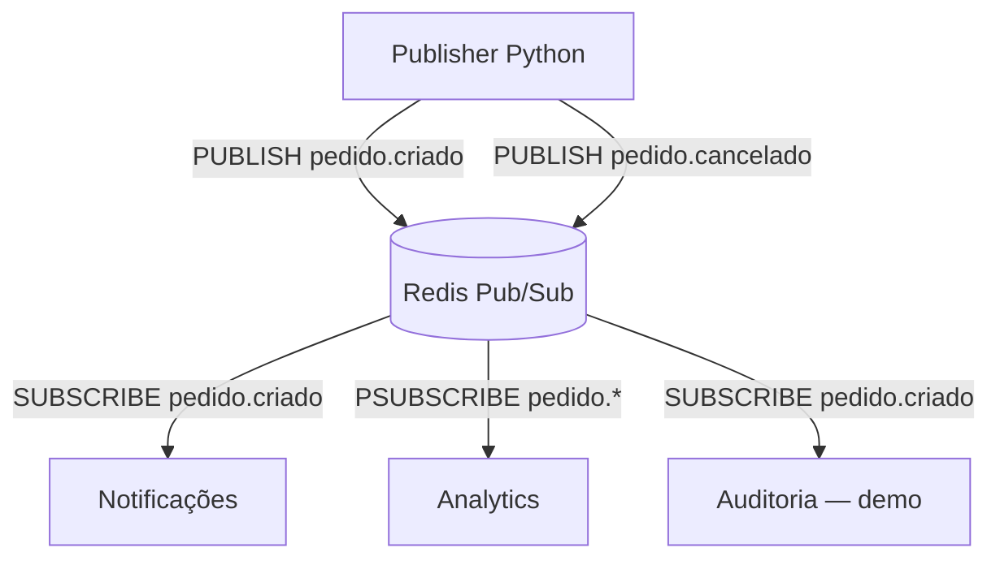

# Lab 02 — Redis Pub/Sub com Python

> **Mensageria orientada a eventos:** publishers, múltiplos subscribers, canais, assinaturas por padrão (`PSUBSCRIBE`), fan-out e comportamento durante desconexões.

**Stack:** Python 3.11 · Redis · Docker Compose · `redis-py`  
**Ambiente utilizado:** macOS Big Sur 11.7.11 (Intel x86_64)  
**Pré-requisito conceitual:** [Lab 01 — Fila FIFO com Redis](https://github.com/andersonluizsanchescarluccipereira/redis-fifo-lab)

## 1. Objetivo

Construir um laboratório reproduzível para analisar o modelo **Publish/Subscribe (Pub/Sub)** do Redis e compará-lo à fila FIFO implementada com Redis Lists.

Ao concluir, você deverá conseguir:

- Publicar eventos em canais, como `pedido.criado` e `pedido.cancelado`.
- Manter vários subscribers independentes ouvindo o mesmo canal (**fan-out**).
- Roteá-los por canal exato (`SUBSCRIBE`) ou padrão glob (`PSUBSCRIBE 'pedido.*'`).
- Verificar quantos assinantes estão conectados e inspecionar métricas auxiliares.
- Demonstrar que uma publicação feita enquanto um subscriber está desconectado **não é reentregue** quando ele volta.
- Explicar a diferença entre entrega ao subscriber, processamento de negócio e confirmação (**ACK**).

> **Escopo:** este laboratório demonstra comunicação em tempo real, não mensageria durável. Redis Pub/Sub é **at-most-once**: não armazena eventos para replay e não possui ACK nativo.

## 2. Arquitetura



Uma publicação em `pedido.criado` chega a **todos** os subscribers conectados que assinam esse canal, inclusive por padrão. Uma publicação em `pedido.cancelado` chega ao subscriber `analytics`, que acompanha `pedido.*`.

**Observação:** o serviço “Auditoria” é apenas um nome didático. Pub/Sub **não deve ser a única fonte de uma trilha de auditoria**, pois eventos podem ser perdidos em desconexões.

### Redis Lists FIFO × Redis Pub/Sub

| Propriedade | Lists FIFO (Lab 01) | Pub/Sub (Lab 02) |
|---|---|---|
| Finalidade | Distribuir trabalho entre consumidores | Transmitir eventos aos assinantes ativos |
| Entrega | Um consumidor retira cada item da lista | Todos os assinantes correspondentes recebem a publicação |
| Armazenamento | Mensagens ficam na lista até serem removidas | O canal não mantém histórico de mensagens |
| Subscriber desconectado | Pode consumir itens ainda presentes depois | Perde as publicações ocorridas durante a ausência |
| ACK | Implementado pelo laboratório anterior | Não existe ACK nativo |
| Replay | Depende da implementação | Não existe no Pub/Sub clássico |

## 3. Estrutura de arquivos

Este README documenta os arquivos já utilizados e os scripts acrescentados na segunda etapa:

```text
redis-fifo-lab/              # ou o diretório escolhido para a branch
├── publicador.py            # exemplo inicial, já testado
├── assinante.py             # exemplo inicial, já testado
├── publicador_eventos.py    # publisher parametrizável, com métricas
├── assinante_eventos.py     # subscriber parametrizável, com métricas
├── docker-compose.yml       # ou compose.yaml: serviço chamado redis
└── README.md
```

Os arquivos `publicador_eventos.py` e `assinante_eventos.py` são os da **etapa 2** do laboratório. Os exemplos anteriores (`publicador.py` e `assinante.py`) podem ser mantidos para comparação. **O dashboard de Pub/Sub ainda não faz parte desta etapa**; sua implementação está no roadmap.

## 4. Requisitos e instalação

- Python **3.11** (ou outra versão suportada pelo `redis-py` instalado).
- Docker com Docker Compose.
- Redis disponível em `localhost:6379`.
- Biblioteca Python `redis`; **não é necessário instalar Streamlit, Pandas ou PyArrow**.

### 4.1. Verifique a branch de trabalho

```bash
git branch --show-current
```

> Execute as atividades na branch destinada ao Lab 02; não é preciso alterar o histórico da branch `main`.

### 4.2. Inicie o Redis

A partir da raiz do projeto, onde está o arquivo de Compose:

```bash
docker compose up -d
docker compose ps
docker compose exec redis redis-cli PING
```

**Saída esperada do último comando:** `PONG`.

> Se o container Redis já estiver em execução, não é necessário subir outra instância. Os comandos acima pressupõem que o serviço no Compose se chama `redis`.

### 4.3. Ative o ambiente virtual e instale a dependência

Caso já exista a pasta `venv`:

```bash
source venv/bin/activate
```

Caso ainda não exista:

```bash
python3 -m venv venv
source venv/bin/activate
```

Instale apenas a biblioteca necessária:

```bash
python3 -m pip install 'redis>=5,<8'
python3 -c 'import redis; print(redis.Redis(host="localhost", port=6379).ping())'
```

**Saída esperada:** `True`.

## 5. Experimento A — Fan-out em um único canal

Abra **quatro terminais**, cada um no diretório do projeto e com o ambiente virtual ativado. Inicie os três subscribers antes do publisher.

**Terminal 1 — Notificações:**

```bash
python3 assinante_eventos.py --nome notificacoes --canal pedido.criado
```

**Terminal 2 — Analytics (assinatura por padrão):**

```bash
python3 assinante_eventos.py --nome analytics --padrao 'pedido.*'
```

**Terminal 3 — Auditoria didática:**

```bash
python3 assinante_eventos.py --nome auditoria --canal pedido.criado
```

**Terminal 4 — Publisher:**

```bash
python3 publicador_eventos.py --canal pedido.criado --quantidade 5 --intervalo 1
```

### Resultado esperado

Se os três subscribers já estiverem conectados e não houver falhas:

| Subscriber | Eventos recebidos |
|---|---:|
| `notificacoes` | 5 |
| `analytics` | 5 |
| `auditoria` | 5 |

O mesmo evento pode ser recebido pelos três processos. Isso é **fan-out**, não balanceamento de carga entre workers.

O valor retornado por `PUBLISH` informa o número de assinaturas/clientes alcançados naquele momento; **não confirma que a lógica de negócio foi executada**.

## 6. Experimento B — Canais e roteamento com `PSUBSCRIBE`

Com os mesmos subscribers ainda conectados, publique eventos de cancelamento:

```bash
python3 publicador_eventos.py --canal pedido.cancelado --quantidade 3 --intervalo 1
```

**Resultado esperado:** somente `analytics` recebe esses três eventos, porque seu padrão `pedido.*` corresponde tanto a `pedido.criado` quanto a `pedido.cancelado`.

| Assinatura | `pedido.criado` | `pedido.cancelado` |
|---|:---:|:---:|
| `SUBSCRIBE pedido.criado` | ✅ | — |
| `PSUBSCRIBE pedido.*` | ✅ | ✅ |

> `PSUBSCRIBE` usa correspondência por padrão glob, **não expressões regulares**. Se um mesmo cliente assinar um canal exato e um padrão que também combine com ele, poderá receber duas notificações da mesma publicação (`message` e `pmessage`).

## 7. Inspeção com Redis CLI

Execute em um terminal adicional enquanto os subscribers estiverem conectados.

**Contagem de assinaturas diretas por canal:**

```bash
docker compose exec redis redis-cli PUBSUB NUMSUB pedido.criado pedido.cancelado
```

Com a configuração do experimento, são esperados **2 assinantes diretos** em `pedido.criado` e **0** em `pedido.cancelado`. O subscriber por padrão **não entra** nessa contagem.

**Quantidade de padrões únicos ativos:**

```bash
docker compose exec redis redis-cli PUBSUB NUMPAT
```

Resultado esperado no cenário: `1` padrão único (`pedido.*`). **Não confunda `NUMPAT` com quantidade de clientes que utilizam padrões.**

**Canais com assinantes diretos:**

```bash
docker compose exec redis redis-cli PUBSUB CHANNELS
```

**Contadores auxiliares escritos pelos nossos scripts:**

```bash
docker compose exec redis redis-cli HGETALL lab:pubsub:metricas
docker compose exec redis redis-cli HGETALL lab:pubsub:publicados:canal
docker compose exec redis redis-cli HGETALL lab:pubsub:recebidos
docker compose exec redis redis-cli HGETALL lab:pubsub:recebidos:canal
```

Esses Hashes são **instrumentação adicional do laboratório**, não são criados automaticamente pelo mecanismo Redis Pub/Sub. Contam publicações ou mensagens processadas pelo código de instrumentação; não são ACKs do broker.

## 8. Experimento C — Desconexão e perda de eventos

1. Deixe `notificacoes` e `analytics` conectados.
2. No terminal `auditoria`, pressione **Ctrl+C** para desligar somente esse subscriber.
3. Publique dez eventos:

   ```bash
   python3 publicador_eventos.py --canal pedido.criado --quantidade 10 --intervalo 0.5
   ```

4. Reinicie a auditoria:

   ```bash
   python3 assinante_eventos.py --nome auditoria --canal pedido.criado
   ```

5. Publique mais um evento:

   ```bash
   python3 publicador_eventos.py --canal pedido.criado --quantidade 1 --intervalo 1
   ```

### Resultado esperado

- A auditoria **não recebe retroativamente** os dez eventos publicados enquanto estava desligada.
- Depois de reconectar, ela recebe apenas **novas publicações** correspondentes ao canal.
- Notificações e Analytics continuam recebendo os eventos enquanto permanecerem conectados.

**Semântica:** Redis Pub/Sub opera em **at-most-once**. Eventos publicados para assinantes desconectados não ficam armazenados para reentrega. Um subscriber lento ou uma falha durante o tratamento da mensagem também pode produzir perda do ponto de vista da aplicação.

> **Como medir perdas corretamente?** Registre IDs de eventos publicados e recebidos por subscriber e compare uma janela de teste conhecida. Não subtraia simplesmente `recebidos` de `publicados`: uma única publicação pode gerar vários recebimentos por fan-out.

## 9. Modelo de evento e métricas

Os scripts estendidos publicam JSON com a seguinte estrutura:

```json
{
  "id": "uuid-da-publicacao",
  "tipo": "pedido.criado",
  "sequencia": 1,
  "publicado_em": "2026-11-02T12:00:00+00:00"
}
```

- `id`: identificador da publicação, útil para rastrear eventos e identificar eventuais duplicações na instrumentação.
- `tipo`: nome do canal/evento.
- `sequencia`: número **local à execução do publisher**, não uma ordenação global entre produtores.
- `publicado_em`: timestamp UTC da publicação.

| Métrica / chave | Significado | Limitação |
|---|---|---|
| `lab:pubsub:metricas` (`publicados`) | Contador de chamadas de publicação registradas pelo script | Instrumentação feita **após** `PUBLISH`; não é transacional com a entrega |
| `lab:pubsub:publicados:canal` | Publicações por canal | Acumulado entre execuções, até limpeza |
| `lab:pubsub:recebidos` | Recebimentos contabilizados por nome do subscriber | Não equivale a persistência ou ACK de negócio |
| `lab:pubsub:recebidos:canal` | Recebimentos contabilizados por canal | Um evento pode ser contabilizado várias vezes por fan-out |

Em ambientes com múltiplas instâncias, use identidades únicas na instrumentação se precisar medir o desempenho de cada processo separadamente.

## 10. Garantias, limitações e trade-offs

**O que este laboratório demonstra:**

- Comunicação desacoplada entre publisher e subscribers.
- Distribuição *fan-out* para assinantes conectados.
- Roteamento por canal e por padrão.
- Ausência de replay do Pub/Sub clássico após desconexões.
- Instrumentação mínima com estruturas Hash do Redis.

**O que ele não garante:**

- Entrega durável ou *at-least-once*.
- ACK nativo e recuperação automática de eventos perdidos.
- Exatamente uma execução de efeitos de negócio.
- Histórico de eventos no canal.
- Uma trilha de auditoria confiável baseada apenas em Pub/Sub.

**Cenários adequados:** notificações transitórias, atualização de interfaces em tempo real e invalidação de cache, quando a perda de algumas notificações for tolerável ou existir reconciliação com uma fonte persistente.

**Se a perda de eventos for inaceitável:** registre o estado em um armazenamento durável e considere **Redis Streams com Consumer Groups**, ou outra plataforma de mensageria compatível com os requisitos de entrega, retenção e operação.

## 11. Troubleshooting

**`Connection refused` ou Redis indisponível**

```bash
docker compose ps
docker compose exec redis redis-cli PING
```

**Nenhum evento aparece no subscriber**

- Inicie os subscribers **antes** do publisher; não há replay.
- Confira se o canal publicado é o mesmo canal assinado.
- Use aspas em padrões como `'pedido.*'` para impedir expansão pelo shell.
- Confira se ambos estão conectados à mesma instância Redis.

**`ModuleNotFoundError: No module named 'redis'`**

```bash
source venv/bin/activate
python3 -m pip install 'redis>=5,<8'
```

**Contadores não começaram em zero**

As métricas são acumuladas em Hashes separados. Para zerar **somente as métricas deste Lab 02**, sem tocar nas filas do Lab 01:

```bash
docker compose exec redis redis-cli DEL \
  lab:pubsub:metricas \
  lab:pubsub:publicados:canal \
  lab:pubsub:recebidos \
  lab:pubsub:recebidos:canal
```

> Não use `FLUSHALL` para limpar este experimento se outros laboratórios compartilham o Redis.

## 12. Próximas evoluções

- [x] **Etapa 1:** publisher e três subscribers no terminal.
- [ ] **Etapa 2:** validar dois canais e assinatura `pedido.*`.
- [ ] **Etapa 3:** registrar evidências do experimento de desconexão.
- [ ] **Etapa 4:** dashboard HTML + HTTP com publicações/s, recebimentos por subscriber e canais ativos (sem Streamlit).
- [ ] **Etapa 5:** testes automatizados, múltiplos publishers e cenários de falha.
- [ ] **Lab 03:** Redis Streams com `XADD`, `XREADGROUP`, `XACK`, `XPENDING` e `XAUTOCLAIM`.

> Atualize as caixas do checklist à medida que **você executar e validar** os experimentos. Os itens pendentes não devem ser interpretados como funcionalidades já concluídas.

## 13. Finalização e versionamento

Para interromper os subscribers, pressione `Ctrl+C`. Se o Redis foi iniciado apenas para este laboratório, pare-o com:

```bash
docker compose down
```

Esse comando preserva o volume. **Evite `docker compose down -v`** se houver mensagens ou dados de outros laboratórios que você deseje preservar.

Para registrar somente o README na branch atual:

```bash
git status
git add README.md
git commit -m "docs: document Redis PubSub lab and experiments"
git push -u origin "$(git branch --show-current)"
```

Não é necessário `git push --force`.

## Referências

- [Redis — Pub/Sub: conceitos e casos de uso](https://redis.io/docs/latest/develop/use-cases/pub-sub/)
- [Redis — Exemplo Pub/Sub com redis-py](https://redis.io/docs/latest/develop/use-cases/pub-sub/redis-py/)
- [Redis — PUBSUB NUMSUB](https://redis.io/docs/latest/commands/pubsub-numsub/)
- [Redis — PUBSUB NUMPAT](https://redis.io/docs/latest/commands/pubsub-numpat/)
- [redis-py](https://redis-py.readthedocs.io/)

---

**Aprendizado central:** Redis Pub/Sub resolve a **distribuição de eventos para assinantes conectados**. Ele não substitui uma fila durável quando o requisito é recuperar mensagens após falhas ou desconexões.
